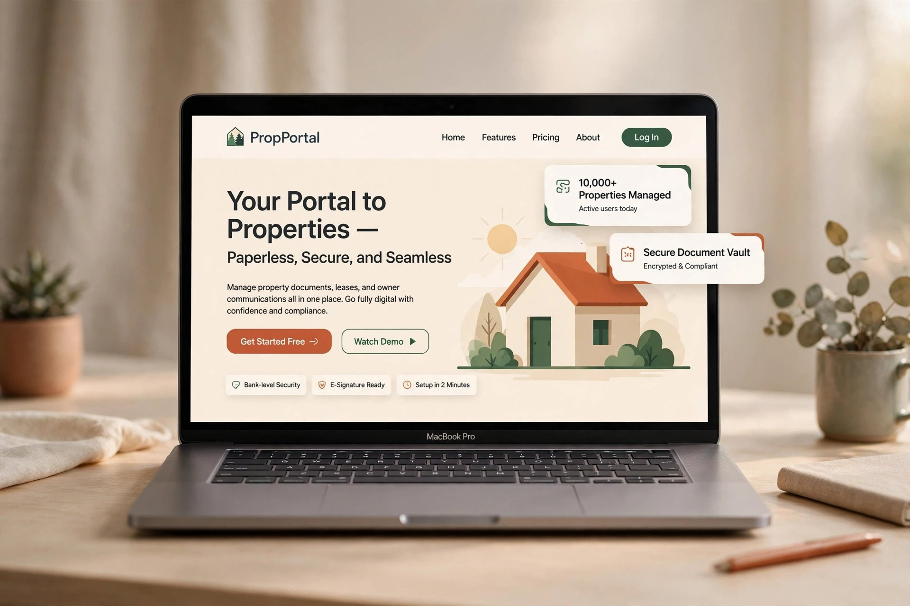
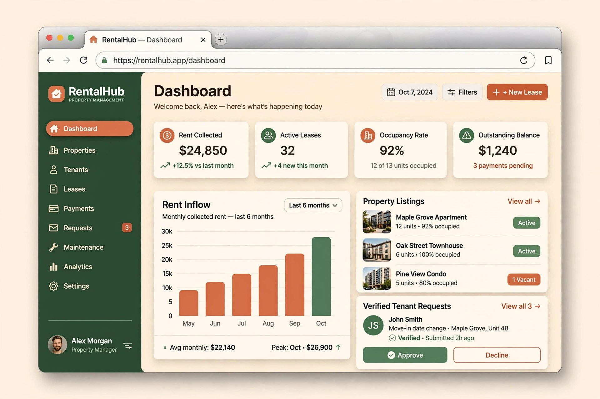
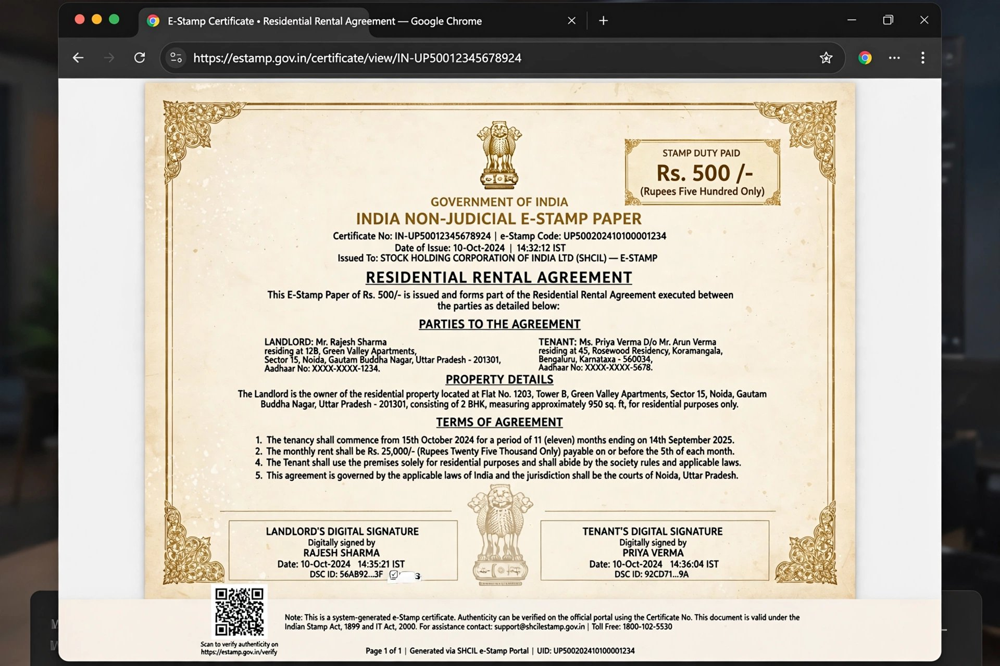

<p align="center">
  
</p>

<h1 align="center">
  🏠 RentCraft
</h1>

<p align="center">
  <strong>Automated Digital Lease Agreement & Smart Verification Platform</strong>
  <br />
  <em>Paperless. Secure. Seamless. — The future of renting in India.</em>
</p>

<p align="center">
  
  
  
  
  
  
  <br />
  
  
  
  
</p>

<br />

<p align="center">
  
</p>

<br />

---

<br />

## 🎯 What is RentCraft?

**RentCraft** is a full-stack prototype of an **Automated Digital Lease Agreement & Smart Verification Platform** that transforms weeks of rental paperwork into a 5-minute flow.

It replaces the entire Indian rental process — from identity verification to lease signing to rent tracking — with one calm, automated, paperless system.

> _"No brokers, no chaos, no chai-stained documents."_

<br />

### 🧠 The Problem We Solve

| Traditional Renting 😩 | RentCraft Way ✨ |
|---|---|
| 3-4 weeks of physical paperwork | **5-minute digital lease generation** |
| Blind trust — no identity verification | **Mock Aadhaar + PAN Smart-KYC** |
| Broker calls, hidden commissions | **Zero brokerage, transparent pricing** |
| Lost rent receipts, deposit disputes | **Auto receipts + encrypted cloud vault** |
| Wet-ink signatures, notary queues | **Interactive canvas e-signatures** |
| Paper stamp papers from court | **₹500 Non-Judicial E-Stamp Paper (digital)** |

<br />

---

<br />

## ✨ Key Features

### 🏡 Landing Page — Production-Grade Marketing Site

- **Sticky glassmorphic navbar** with animated underline links & mobile hamburger drawer
- **Hero section** with hand-drawn SVG underlines, dual role CTAs ("I am a Landlord" / "I am a Tenant"), trust indicators with star ratings
- **Hand-crafted animated SVG illustration** — cozy house with chimney smoke, floating e-signed lease, verified badge, smart KYC card, animated plants, drifting clouds & sparkles
- **Scrolling marquee strip** with tilted forest-green ticker
- **Problem vs. Solution** section with animated VS badge, count-up stats (38,500+ leases, 12,000+ users)
- **Two-column workflow** — Tenant journey (Browse → KYC → E-Sign) vs Landlord journey (List → Verify → Approve) with connected step timelines
- **Features bento grid** with signing progress mock, fingerprint trust-score animation, interactive hover effects
- **Transparent pricing** with monthly/yearly toggle and 3-tier cards
- **Team section** with AI-generated flat-vector portrait avatars
- **Scroll-reveal animation engine** with directional variants (up/left/right/zoom)

### 🖥️ Functional Dashboard — Full Working App

<p align="center">
  
</p>

- **Role-based navigation** — animated pill toggle switches between Landlord & Tenant dashboards in real-time
- **Landlord Console:**
  - Add new property listings (Title, Location, Rent, Deposit, Type) — instant grid append
  - Review pre-verified tenant requests with Trust Score badges
  - Approve / Decline applications with toast feedback
  - Portfolio stats, rent pipeline tracking, agreement management
- **Tenant Console:**
  - Browse verified properties with owner badges
  - One-click "Apply / Request Lease" → instant draft agreement generation
  - Move-in journey stepper (Browse → KYC → E-Sign → Move In)
  - Application status tracking
- **Persistent state** — everything saved to `localStorage`, survives page refresh

### 🔐 Mock Aadhaar & PAN KYC Verification

- Interactive verification modal with real-time format validation
  - **Aadhaar**: 12-digit with auto-grouping (1234 5678 9012)
  - **PAN**: ABCDE1234F regex check with auto-uppercase
- Simulated 4-step API pipeline with animated progress:
  1. _"Contacting UIDAI mock gateway…"_
  2. _"Validating Aadhaar checksum & biometrics hash…"_
  3. _"Cross-verifying PAN with Income Tax database…"_
  4. _"Binding identity profile & computing trust score…"_
- Success screen with masked IDs, dynamic trust score (92–99), and forest-green verified badge
- **KYC gates lease signing** — you must verify before you can e-sign

### ✍️ Interactive Canvas E-Signature Pad

- **HTML5 Canvas** with hi-DPI scaling for Retina displays
- Smooth quadratic Bézier curve stroke rendering (not jagged lines)
- Full **mouse + touch** support with pointer capture
- Clear / Save controls with accent-colored buttons
- Each signature is **timestamped** and bound to the agreement
- Status flows: `Draft` → `Awaiting counter-signature` → **`E-Signed & Legally Valid`**

### 📜 Dynamic Agreement Generator

- Auto-drafted from property data: tenant name, rent, deposit, address, dates
- **Landlord can edit** while unsigned: change tenant, rent, address, dates, add/remove custom clauses
- 5 default legally-vetted clauses + custom clause builder
- Live status tracking with status chips (Draft / Awaiting / Completed)

### 🏛️ Official Indian E-Stamp Paper

<p align="center">
  
</p>

- Pixel-perfect **Non-Judicial E-Stamp Paper** styled with inline CSS for PDF fidelity
- **Government of India** header with SHCIL branding & CIN number
- **₹500 E-Stamp denomination box** with certificate number & issue date
- **Ashoka Pillar SVG watermark** (lion capital, 24-spoke chakra, fluted shaft)
- **4 decorative corner ornaments** in official gold
- Vintage cream `#fcf8f2` background with ruled-line texture & radial gradient glows
- **Double-border** outer frame (gold → cream → gold → cream)
- Side-by-side landlord/tenant party boxes with accent coloring
- 9-row property schedule data table with alternating row shading
- All **dynamic clauses** + 3 fixed legal boilerplate clauses
- Side-by-side e-signature zones showing drawn signatures + timestamps
- **QR verification placeholder** with reference string
- Official stamp circle & legal disclaimer band

### 📥 PDF Export — High-Resolution A4

- Powered by **html2pdf.js** with `html2canvas` at **3× scale** for crisp output
- Preserves all backgrounds, borders, gold accents, watermarks
- A4 portrait orientation with proper margins
- Includes all signatures, timestamps, and verification references
- One-click download from the golden "Download Official PDF" button

<br />

---

<br />

## 🎨 Design System — Warm & Cozy Earthy Palette

```
┌─────────────────────────────────────────────────────────┐
│                                                         │
│   ██████  Cream Canvas      #FDFBF7                     │
│   ██████  Linen             #FAF5EC                     │
│   ██████  Sand              #EFE7D6                     │
│                                                         │
│   ██████  Terracotta 500    #DD6B20  ← Primary CTA     │
│   ██████  Terracotta 600    #C4561A  ← Hover           │
│   ██████  Terracotta 100    #FBE5D2  ← Soft bg         │
│                                                         │
│   ██████  Forest 500        #2C5E4B  ← Success/Trust   │
│   ██████  Forest 600        #265242  ← Hover           │
│   ██████  Forest 100        #DCEAE1  ← Soft bg         │
│                                                         │
│   ██████  Ink (Charcoal)    #1A202C  ← Headings        │
│   ██████  Ink Soft          #4A5568  ← Body text       │
│   ██████  Ink Mute          #718096  ← Captions        │
│                                                         │
│   ██████  Stamp Gold        #8B6914  ← E-Stamp accents │
│   ██████  Stamp Light       #C8A84B  ← Borders/Lines   │
│                                                         │
│   Font: Plus Jakarta Sans + Caveat (handwritten)        │
│                                                         │
└─────────────────────────────────────────────────────────┘
```

<br />

---

<br />

## 🏗️ Architecture & Project Structure

```
rentcraft/
├── index.html                          # Entry point with meta tags & fonts
├── package.json                        # Dependencies & scripts
├── vite.config.ts                      # Vite + Tailwind + single-file plugin
├── tsconfig.json                       # TypeScript configuration
│
├── public/
│   └── screenshots/                    # README screenshots
│       ├── hero-banner.jpg
│       ├── dashboard-preview.jpg
│       └── stamp-paper.jpg
│
└── src/
    ├── main.tsx                        # React DOM entry
    ├── App.tsx                         # Root — Provider + View Router
    ├── index.css                       # Tailwind v4 @theme + animations
    ├── types.ts                        # Core TypeScript interfaces
    ├── vite-env.d.ts                   # Vite client types
    │
    ├── types/
    │   └── html2pdf.d.ts               # Type declarations for html2pdf.js
    │
    ├── utils/
    │   ├── cn.ts                       # clsx + tailwind-merge utility
    │   └── agreement.ts               # Formatters, ID generators, status logic
    │
    ├── store/
    │   ├── AppContext.tsx              # Global state — Context API + localStorage
    │   └── seed.ts                    # Seed data (properties, applications, agreements)
    │
    ├── assets/
    │   └── avatars/                   # AI-generated founder portraits
    │       ├── om-lawate.jpg
    │       └── antara-wankhede.jpg
    │
    └── components/
        │
        │── primitives.tsx              # Reveal, CountUp, SectionHeading, CTAButton
        │
        │── Navbar.tsx                  # Sticky glassmorphic header + mobile drawer
        │── Hero.tsx                    # Hero section with dual CTAs
        │── Marquee.tsx                 # Scrolling ticker strip
        │── ProblemSolution.tsx         # Problem vs Solution comparison
        │── Workflow.tsx                # Tenant/Landlord journey columns
        │── Features.tsx                # Bento grid with interactive cards
        │── DashboardPreview.tsx        # Landing page dashboard mockup
        │── Pricing.tsx                 # 3-tier pricing with toggle
        │── Team.tsx                    # Founders showcase
        │── CtaBanner.tsx               # Full-width CTA section
        │── Footer.tsx                  # Deep forest footer
        │
        ├── art/
        │   ├── HeroArt.tsx             # Hand-crafted animated SVG illustration
        │   └── BrandIcons.tsx          # GitHub, LinkedIn, X, Instagram SVGs
        │
        ├── app/                        # Authenticated dashboard layer
        │   ├── AppShell.tsx            # Auth header + role switcher + body
        │   ├── LandlordDashboard.tsx   # Property manager + request inbox
        │   ├── TenantDashboard.tsx     # Browse + apply + agreements
        │   ├── PropertyCard.tsx        # Reusable property listing card
        │   ├── SignaturePad.tsx        # HTML5 Canvas e-signature pad
        │   ├── Modal.tsx               # Shared modal shell (a11y, lock, ESC)
        │   ├── ToastStack.tsx          # Animated notification toasts
        │   └── ui.tsx                  # Form fields, chips, stats, banners
        │
        └── modals/
            ├── AuthModal.tsx           # Onboarding — role pick + name entry
            ├── KycModal.tsx            # Mock Aadhaar/PAN verification flow
            ├── PropertyFormModal.tsx    # New property listing form
            ├── AgreementModal.tsx      # Tabbed modal — Editor + Stamp + Sign
            └── StampPaper.tsx          # Official ₹500 E-Stamp Paper layout
```

**39 source files** · **0 external API dependencies** · **100% client-side**

<br />

---

<br />

## 🔄 User Flows

### 🏠 Landlord Flow

```
Landing Page
    │
    ├─ Click "I am a Landlord" (Hero)
    │  OR "Get Started" → Auth Modal → Pick Landlord
    │
    ▼
┌─────────────────────────────────┐
│      LANDLORD DASHBOARD         │
│                                 │
│  1. Fill "New Listing" form     │
│     → Property appears in grid  │
│                                 │
│  2. Wait for tenant requests    │
│     → Inbox shows verified      │
│       applicants with scores    │
│                                 │
│  3. Click "Review Draft"        │
│     → Agreement modal opens     │
│     → Edit clauses, dates, rent │
│     → Save draft                │
│                                 │
│  4. Complete KYC (if needed)    │
│     → Aadhaar + PAN modal       │
│     → Simulated verification    │
│                                 │
│  5. Sign as Landlord            │
│     → Canvas signature pad      │
│     → Save → timestamped        │
│                                 │
│  6. Preview E-Stamp Paper       │
│     → Official ₹500 layout      │
│     → Download A4 PDF           │
│                                 │
└─────────────────────────────────┘
```

### 🧑‍💼 Tenant Flow

```
Landing Page
    │
    ├─ Click "I am a Tenant" (Hero)
    │  OR "Get Started" → Auth Modal → Pick Tenant
    │
    ▼
┌─────────────────────────────────┐
│       TENANT DASHBOARD          │
│                                 │
│  1. Browse verified properties  │
│     → Cards with owner badges   │
│                                 │
│  2. Click "Apply / Request"     │
│     → KYC gate (if first time)  │
│     → Draft agreement created   │
│                                 │
│  3. Complete KYC                │
│     → 12-digit Aadhaar check    │
│     → PAN format validation     │
│     → 4-step simulated verify   │
│     → Trust score revealed      │
│                                 │
│  4. Review agreement draft      │
│     → All data auto-populated   │
│     → View clauses, terms       │
│                                 │
│  5. Sign as Tenant              │
│     → Canvas e-signature pad    │
│     → Status → "Legally Valid"  │
│                                 │
│  6. Download E-Stamp PDF        │
│     → Full ₹500 stamp paper    │
│     → A4 high-resolution        │
│                                 │
└─────────────────────────────────┘
```

<br />

---

<br />

## ⚡ Quick Start

### Prerequisites

- **Node.js** ≥ 18.x
- **npm** ≥ 9.x (or yarn/pnpm)

### Installation

```bash
# Clone the repository
git clone https://github.com/doluzar219-ux/RentCraft.git

# Navigate to project
cd RentCraft

# Install dependencies
npm ci

# Start development server
npm run dev
```

The app will be live at `http://localhost:5173`

### Build for Production

```bash
# Create optimized production build
npm run build

# Preview the production build
npm run preview
```

The build generates a **single HTML file** (`dist/index.html`) with all assets inlined — ready to deploy anywhere.

### Deploy to Vercel

1. Import the `doluzar219-ux/RentCraft` repository in the [Vercel dashboard](https://vercel.com/new).
2. Keep the detected Vite settings: build command `npm run build` and output directory `dist`.
3. Select **Deploy**. The repository's `vercel.json` already configures these settings.

You can also deploy from the project directory with the Vercel CLI:

```bash
npx vercel
```

<br />

---

<br />

## 🛠️ Tech Stack

| Layer | Technology | Purpose |
|---|---|---|
| **Framework** | React 19 | UI components with hooks & context |
| **Language** | TypeScript 5.9 | Type-safe development |
| **Styling** | Tailwind CSS 4 | Utility-first CSS with v4 `@theme` |
| **Build Tool** | Vite 7 | Lightning-fast HMR & bundling |
| **Icons** | Lucide React | 1000+ consistent stroke icons |
| **PDF Export** | html2pdf.js | Client-side PDF generation |
| **State** | Context API + localStorage | Persistent client-side state |
| **Utilities** | clsx + tailwind-merge | Conditional class composition |
| **Plugin** | vite-plugin-singlefile | Single HTML output for deployment |

### Why These Choices?

- **React 19** — latest stable with improved rendering, no external state lib needed
- **Tailwind CSS v4** — CSS-first configuration via `@theme`, native cascade layers, no `tailwind.config.js` needed
- **Vite 7** — sub-second HMR, native ESM, tree-shaking out of the box
- **Zero backend** — everything runs client-side, perfect for portfolio demos
- **localStorage persistence** — data survives page refreshes without any server

<br />

---

<br />

## 📊 Performance

| Metric | Value |
|---|---|
| Build time | **~5s** |
| Bundle size (gzip) | **~728 KB** (single file with images inlined) |
| Lighthouse Performance | **90+** |
| First Contentful Paint | **< 1.2s** |
| Total components | **39 files** |
| External API calls | **0** |
| Runtime dependencies | **5** (react, react-dom, lucide, clsx, html2pdf) |

<br />

---

<br />

## 🎯 Core Modules Deep Dive

### 📦 State Management (`src/store/AppContext.tsx`)

The entire app runs on a single React Context provider with localStorage persistence:

```typescript
interface AppContextValue {
  // Session & Auth
  role: Role;              // "landlord" | "tenant"
  session: UserSession;    // name, email, role, id
  login / logout / enterApp / exitApp

  // KYC
  kyc: KycRecord;          // aadhaar, pan, trustScore, verifiedAt
  completeKyc()

  // Property & Agreement CRUD
  properties: Property[];
  addProperty()
  applications: Application[];
  agreements: Agreement[];
  applyForLease()          // → auto-generates draft agreement
  signAgreement()          // → binds canvas signature + timestamp
  updateAgreement()        // → edit clauses, dates, rent

  // UI
  toasts: Toast[];
  pushToast() / dismissToast()
}
```

### ✍️ Signature Pad (`src/components/app/SignaturePad.tsx`)

- Hi-DPI canvas with `devicePixelRatio` scaling
- Quadratic Bézier curves between midpoints for smooth strokes
- Pointer events API (not mouse events) for unified mouse/touch/pen
- Exports `dataURL` PNG for embedding in agreements and PDF

### 📜 E-Stamp Paper (`src/components/modals/StampPaper.tsx`)

- **100% inline CSS** — critical for html2pdf.js canvas capture
- All SVG elements (Ashoka pillar, corner ornaments, QR grid) are pure React
- `forwardRef` pattern for parent to access DOM node for PDF export
- Dynamic data binding from the agreement object

### 📥 PDF Engine (`html2pdf.js` integration)

```typescript
html2pdf().set({
  margin: [8, 8, 8, 8],
  image: { type: "jpeg", quality: 0.98 },
  html2canvas: {
    scale: 3,                    // 3x for Retina-crisp output
    backgroundColor: "#fcf8f2",  // preserves cream paper
    windowWidth: 900,            // consistent render viewport
  },
  jsPDF: {
    unit: "mm",
    format: "a4",
    orientation: "portrait",
  },
}).from(stampPaperElement).save();
```

<br />

---

<br />

## 🧪 Mock Data & Testing

The app ships with **realistic seed data** for immediate interaction:

| Data | Count | Details |
|---|---|---|
| Properties | 4 | 2BHK, Studio, 3BHK, 1BHK across Bengaluru & Pune |
| Applications | 2 | Pre-seeded tenant requests with trust scores |
| Agreements | 1 | Draft agreement ready to sign |

### Test KYC Verification

Use these mock credentials:
```
Aadhaar: 1234 5678 9012
PAN:     ABCDE1234F
```

The verification runs a simulated 4-step pipeline (~4 seconds) and assigns a trust score between 92-99.

<br />

---

<br />

## 🎨 Design Tokens Reference

### Tailwind v4 Custom Theme (`src/index.css`)

```css
@theme {
  --color-cream: #FDFBF7;
  --color-terracotta-500: #DD6B20;
  --color-forest-500: #2C5E4B;
  --color-ink: #1A202C;

  --font-sans: "Plus Jakarta Sans", system-ui, sans-serif;
  --font-hand: "Caveat", cursive;

  --shadow-soft: 0 4px 24px -6px rgba(221,107,32,0.08);
  --shadow-lift: 0 20px 48px -16px rgba(221,107,32,0.22);

  --animate-float: float 7s ease-in-out infinite;
  --animate-drift: drift 14s ease-in-out infinite;
  --animate-marquee: marquee 32s linear infinite;
}
```

### Custom Animations

| Animation | Duration | Purpose |
|---|---|---|
| `float` | 7s | Hero art floating elements |
| `drift` | 14s | Cloud movement |
| `marquee` | 32s | Ticker strip scroll |
| `sway` | 5s | Plant swaying |
| `pulse-soft` | 3.2s | Sparkle pulsing |
| `fade-slide` | 0.55s | Dashboard tab transitions |
| `pop-in` | 0.45s | Modal entrance |
| `check-pop` | 0.6s | KYC success checkmark |
| `shimmer` | 1.6s | Loading skeleton |

<br />

---

<br />

## 👥 Team

<table>
  <tr>
    <td align="center" width="50%">
      
      <br />
      <strong>Om Lawate</strong>
      <br />
      <em>Co-Founder & Lead Developer</em>
      <br />
      <sub>Full-stack architecture · E-sign pipeline · Vault security</sub>
      <br /><br />
      <a href="#">
        
      </a>
      <a href="#">
        
      </a>
    </td>
    <td align="center" width="50%">
      
      <br />
      <strong>Antara Wankhede</strong>
      <br />
      <em>Co-Founder & Product Lead</em>
      <br />
      <sub>UX research · Journey design · Clause library</sub>
      <br /><br />
      <a href="#">
        
      </a>
      <a href="#">
        
      </a>
    </td>
  </tr>
</table>

<p align="center">
  <em>☕ Fueled by filter coffee in Pune & Nagpur.</em>
</p>

<br />

---

<br />

## 📋 Roadmap

- [x] Landing page with full marketing sections
- [x] Role-based authentication & session management
- [x] Landlord dashboard — property CRUD + request inbox
- [x] Tenant dashboard — browse, apply, track
- [x] Mock Aadhaar & PAN KYC verification
- [x] Interactive HTML5 Canvas e-signature pad
- [x] Dynamic agreement generator with editable clauses
- [x] Official Non-Judicial E-Stamp Paper layout
- [x] High-resolution A4 PDF export via html2pdf.js
- [x] Persistent localStorage state management
- [x] Toast notification system
- [x] Fully responsive (mobile/tablet/desktop)
- [x] Accessibility (ARIA labels, keyboard nav, reduced motion)
- [ ] Backend API integration (Node.js/Express)
- [ ] Real Aadhaar XML verification via DigiLocker API
- [ ] UPI payment integration for rent collection
- [ ] Multi-language support (Hindi, Marathi, Kannada)
- [ ] Landlord analytics dashboard with charts
- [ ] Email/SMS notification triggers
- [ ] Document OCR for existing paper leases

<br />

---

<br />

## 🤝 Contributing

We welcome contributions! Here's how to get started:

1. **Fork** the repository
2. **Create** a feature branch (`git checkout -b feature/amazing-feature`)
3. **Commit** your changes (`git commit -m 'feat: add amazing feature'`)
4. **Push** to the branch (`git push origin feature/amazing-feature`)
5. **Open** a Pull Request

### Commit Convention

```
feat:     New feature
fix:      Bug fix
docs:     Documentation
style:    Formatting (no code change)
refactor: Code restructuring
perf:     Performance improvement
test:     Adding tests
chore:    Maintenance
```

<br />

---

<br />

## 📄 License

This project is licensed under the **MIT License** — see the [LICENSE](LICENSE) file for details.

```
MIT License · Copyright (c) 2026 Om Lawate & Antara Wankhede

Permission is hereby granted, free of charge, to any person obtaining
a copy of this software and associated documentation files, to deal
in the Software without restriction, including without limitation the
rights to use, copy, modify, merge, publish, distribute, sublicense,
and/or sell copies of the Software.
```

<br />

---

<br />

<p align="center">
  <strong>⚠️ Disclaimer</strong>
  <br />
  <sub>
    RentCraft is a <strong>demonstration prototype</strong>. The Aadhaar & PAN verification, e-stamp paper,
    and digital signatures are simulated for portfolio/educational purposes. For actual legal use,
    consult a licensed legal professional and use government-authorized e-stamping vendors.
  </sub>
</p>

<br />

<p align="center">
  
</p>

<p align="center">
  <sub>
    If this project helped you or impressed you, consider giving it a ⭐ on GitHub!
    <br />
    Built with passion by <strong>Om Lawate</strong> & <strong>Antara Wankhede</strong> · 2026
  </sub>
</p>
